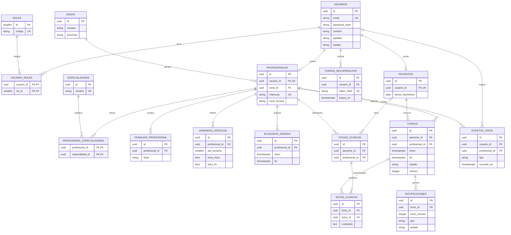

# Diagrama entidad-relación: Portal de Gestión para Profesionales de la Salud

## 1. Objetivo y alcance

Este documento es la propuesta de modelo de datos compartida por Máximo, Priscila y Valentina para el portal. Sirve como referencia para los mocks, contratos de la API, migraciones de PostgreSQL y modelos de Sequelize. **Es un diseño propuesto, no una base ya implementada**: si el equipo cambia una decisión, debe actualizar el diagrama, el diccionario y los contratos afectados.

El [contrato API v1](docs/contrato-api.md) documenta las representaciones, permisos, operaciones y ejemplos propuestos para revisión del equipo.

La fuente funcional es la [propuesta técnica](../Proyecto/Propuesta-Tecnica-Portal-Independientes.docx.pdf); los requisitos de evaluación están en [Prototipo_V1.1.pdf](../2-prototipo/Prototipo_V1.1.pdf) y la [plantilla de entrega](../2-prototipo/Plantilla_entrega_prototipo_v3.docx). Estos enlaces apuntan a archivos fuera del repositorio local: al publicar el documento, compartir esas fuentes por separado o actualizar los enlaces.

La consigna del **prototipo** pide un sistema navegable con respuestas mock y sin generar movimientos en la base de datos. El modelo siguiente contempla la **aplicación final** con persistencia real. Para evaluar el prototipo, usar datos ficticios y un modo mock sin escrituras persistentes; altas, bajas y modificaciones pueden simularse en memoria o responder 2xx, aclarando el comportamiento. Mantener la misma forma de respuesta acordada para no obligar al frontend a cambiar al conectar PostgreSQL.

Para la entrega, la consigna solicita el DER como imagen o PDF; la plantilla también permite indicar un enlace. Este Markdown es la fuente editable: **exportar el diagrama legible a imagen o PDF o verificar con el docente que acepte el enlace**.

### Criterios de diseño propuestos

- Un usuario puede tener uno o más roles: paciente, profesional o administrador. Los datos específicos de paciente y profesional están en perfiles separados.
- Un profesional tiene una zona principal y una dirección de atención; puede tener varias especialidades. Varios consultorios o zonas por profesional quedan fuera de esta primera versión.
- El canal de contacto directo se resuelve inicialmente mostrando los datos de contacto autorizados del profesional; no se modela chat interno.
- La ficha de un paciente para un profesional se identifica por el par paciente-profesional. Las notas son privadas de ese profesional. No se asume una historia clínica compartida entre profesionales.
- Recordatorios, recuperación de contraseña y métricas se modelan para el producto final; en el prototipo pueden ser simulados.
- Se propone usar una zona horaria IANA por profesional, inicialmente `America/Argentina/Buenos_Aires`, y almacenar fechas de eventos como `timestamptz`.

## 2. Diagrama

El diagrama muestra las claves y los atributos que permiten entender las relaciones. El detalle completo de campos y reglas está en el diccionario de la sección 4. `PK` identifica una clave primaria; `FK`, una clave foránea; `UK`, un valor único.

### Lectura de cardinalidades

`||` significa exactamente uno; `o|`, cero o uno; `o{`, cero o muchos. Por ejemplo, cada turno pertenece a un paciente y a un profesional, y cada uno puede tener muchos turnos. Una nota pertenece a una ficha y puede asociarse a un turno; un turno puede tener varias notas.

## 3. Convenciones comunes

- PostgreSQL; nombres de tablas y columnas en `snake_case`. Las PK son UUID salvo `roles` y las tablas de unión, que tienen clave compuesta.
- Cada tabla con PK UUID la genera en el servidor o en PostgreSQL. Las columnas `creado_en` y `actualizado_en` son `timestamptz NOT NULL` con valores automáticos. Agregarlas a todas las tablas salvo que se indique lo contrario; en tablas de unión basta `creado_en`.
- `Obligatorio` significa `NOT NULL`; `opcional` admite `NULL`. Las longitudes de cadenas son límites máximos propuestos, no validación suficiente por sí sola.
- Una FK no implica cascada de borrado por defecto. Salvo tablas de unión o tokens, usar `RESTRICT` para registros con historial. Los catálogos y usuarios se desactivan en vez de eliminarse cuando tienen referencias.
- Las migraciones son la fuente de verdad del esquema. Los modelos y asociaciones Sequelize deben reflejarlas; no depender de `sync({ force: true })` en producción.
- Se indica cada identificador con `_id`; las fechas de nacimiento usan `date`, horarios recurrentes `time` y eventos concretos `timestamptz`.

## 4. Diccionario de datos

En cada tabla se sobreentienden los campos comunes de la sección 3. Todos los ID listados son obligatorios salvo que se indique lo contrario.

### 4.1. Acceso y perfiles

#### `usuarios`

| Campo | Tipo | Regla y finalidad |
|---|---|---|
| `id` | UUID | PK. |
| `nombre`, `apellido` | varchar(100) | Obligatorios. |
| `email` | varchar(254) | Obligatorio, único sin distinguir mayúsculas/minúsculas; normalizar y validar en el servidor. |
| `password_hash` | text | Obligatorio; hash seguro, nunca contraseña en texto plano. |
| `telefono` | varchar(30) | Opcional; solo mostrar si corresponde y está autorizado. |
| `estado` | varchar(20) | `activo` o `inactivo`; predeterminado `activo`. |

#### `roles` y `usuario_roles`

| Tabla | Campos | Reglas |
|---|---|---|
| `roles` | `id` smallint PK, `codigo` varchar(30) | `codigo` único: `paciente`, `profesional`, `administrador`. Cargar mediante migración o seed. |
| `usuario_roles` | `usuario_id` UUID FK → `usuarios`, `rol_id` smallint FK → `roles` | PK compuesta (`usuario_id`, `rol_id`); un usuario puede tener varios roles. |

La asignación del rol y la creación de su perfil deben ser coherentes y ejecutarse en una transacción. Un perfil existente no habilita por sí solo el acceso si el rol fue retirado.

#### `pacientes`

| Campo | Tipo | Regla y finalidad |
|---|---|---|
| `id` | UUID | PK. |
| `usuario_id` | UUID | FK única → `usuarios.id`: como máximo un perfil de paciente por usuario. |
| `fecha_nacimiento` | date | Opcional; no puede ser futura. |

#### `profesionales`

| Campo | Tipo | Regla y finalidad |
|---|---|---|
| `id` | UUID | PK. |
| `usuario_id` | UUID | FK única → `usuarios.id`: como máximo un perfil profesional por usuario. |
| `zona_id` | UUID | FK → `zonas.id`, obligatoria. |
| `matricula` | varchar(100) | Obligatoria y única en este diseño; validar su formato según jurisdicción antes de implementar. |
| `descripcion` | text | Opcional; presentación pública. |
| `direccion_atencion` | varchar(255) | Obligatoria; lugar de atención. |
| `foto_url` | text | Opcional; referencia a imagen, no archivo binario. |
| `contacto_publico` | varchar(255) | Opcional; canal que el profesional autoriza mostrar. |
| `zona_horaria` | varchar(64) | Obligatoria; identificador IANA válido, por defecto `America/Argentina/Buenos_Aires`. |
| `duracion_consulta_min` | integer | Obligatoria y positiva; duración predeterminada para generar disponibilidad. |
| `visible` | boolean | Obligatorio; controla su aparición en el directorio, sin borrar datos históricos. |

Se propone una matrícula única global para simplificar. Si una persona puede tener varias matrículas o existe numeración repetida por jurisdicción/profesión, reemplazarla por una entidad de matrículas con clave adecuada antes de migrar.

#### `tokens_recuperacion`

| Campo | Tipo | Regla y finalidad |
|---|---|---|
| `id` | UUID | PK. |
| `usuario_id` | UUID | FK → `usuarios.id`. |
| `token_hash` | varchar(255) | Obligatorio, único; guardar solo el hash de un token aleatorio. |
| `expira_en` | timestamptz | Obligatorio. |
| `usado_en` | timestamptz | Opcional; se completa al consumir el token. |

El token es de un solo uso, expira y su consumo debe ser atómico. No incluirlo en logs. La respuesta pública de recuperación no debe revelar si el email existe.

### 4.2. Directorio y catálogos

#### `zonas`

| Campo | Tipo | Regla y finalidad |
|---|---|---|
| `id` | UUID | PK. |
| `nombre` | varchar(100) | Obligatorio; localidad o zona de cobertura. |
| `provincia` | varchar(100) | Obligatoria. |
| `activa` | boolean | Obligatoria; predeterminado `true`. |

Definir unicidad por (`provincia`, `nombre`) sin distinguir mayúsculas/minúsculas. Se propone Argentina como alcance inicial; ampliar el modelo si se necesitan otros países.

#### `especialidades`

| Campo | Tipo | Regla y finalidad |
|---|---|---|
| `id` | UUID | PK. |
| `nombre` | varchar(100) | Obligatorio y único sin distinguir mayúsculas/minúsculas. |
| `activa` | boolean | Obligatoria; predeterminado `true`. |

#### `profesional_especialidades`

| Campo | Tipo | Regla y finalidad |
|---|---|---|
| `profesional_id` | UUID | FK → `profesionales.id`; parte de la PK. |
| `especialidad_id` | UUID | FK → `especialidades.id`; parte de la PK. |

PK compuesta: (`profesional_id`, `especialidad_id`). La creación/publicación de un profesional requiere al menos una especialidad activa; esta regla se valida en el servicio.

#### `trabajos_profesional`

| Campo | Tipo | Regla y finalidad |
|---|---|---|
| `id` | UUID | PK. |
| `profesional_id` | UUID | FK → `profesionales.id`. |
| `titulo` | varchar(150) | Obligatorio. |
| `descripcion` | text | Opcional; contenido de su perfil público. |
| `imagen_url` | text | Opcional. |
| `visible` | boolean | Obligatorio; indica si se publica. |

Solo publicar material autorizado y sin datos identificatorios de pacientes. La carga, validación y almacenamiento físico de archivos no se resuelven con este DER.

### 4.3. Disponibilidad y turnos

#### `horarios_atencion`

| Campo | Tipo | Regla y finalidad |
|---|---|---|
| `id` | UUID | PK. |
| `profesional_id` | UUID | FK → `profesionales.id`. |
| `dia_semana` | smallint | Obligatorio; 1 = lunes, 7 = domingo. |
| `hora_inicio`, `hora_fin` | time | Obligatorios; hora local del profesional, con `hora_inicio < hora_fin`. |
| `vigente_desde`, `vigente_hasta` | date | Inicio obligatorio y fin opcional, inclusivos; `vigente_hasta >= vigente_desde`. |
| `activo` | boolean | Obligatorio; permite desactivar la regla. |

Cada fila define una franja semanal recurrente. Una franja no cruza medianoche: si hace falta, se divide en dos. El servicio debe impedir franjas activas solapadas del mismo profesional para el mismo día y vigencias superpuestas.

#### `bloqueos_agenda`

| Campo | Tipo | Regla y finalidad |
|---|---|---|
| `id` | UUID | PK. |
| `profesional_id` | UUID | FK → `profesionales.id`. |
| `inicio`, `fin` | timestamptz | Obligatorios; `inicio < fin`. Intervalo semiabierto `[inicio, fin)`. |
| `motivo` | varchar(255) | Opcional y privado; no mostrar al paciente. |

Permite bloquear horas, días o períodos. El servicio no debe aceptar bloqueos que colisionen con turnos que ocupan agenda: primero deben cancelarse o reprogramarse explícitamente.

#### `turnos`

| Campo | Tipo | Regla y finalidad |
|---|---|---|
| `id` | UUID | PK. |
| `paciente_id` | UUID | FK → `pacientes.id`. |
| `profesional_id` | UUID | FK → `profesionales.id`. |
| `inicio`, `fin` | timestamptz | Obligatorios; `inicio < fin`. Se conservan aunque cambie la duración configurada. |
| `estado` | varchar(20) | Obligatorio: `reservado`, `cancelado`, `atendido` o `ausente`. |
| `version` | integer | Obligatoria, inicial 1; aumentar al modificar fecha, horario o estado. |
| `cancelado_en` | timestamptz | Opcional; obligatorio si el estado es `cancelado`. |

Reglas acordadas para implementación:

1. Los intervalos son `[inicio, fin)`: un turno puede empezar justo cuando termina otro.
2. Solo `reservado` ocupa disponibilidad futura. `atendido` y `ausente` representan turnos pasados; `cancelado` libera la franja. Definir transiciones en el servicio: `reservado` → `cancelado`, `atendido` o `ausente`; reprogramar cambia horario y aumenta `version`. No aceptar fechas pasadas para una nueva reserva.
3. La reserva o reprogramación debe estar dentro de una franja vigente, respetar la duración acordada, y no solaparse con bloqueos ni otros turnos reservados del profesional. Debe validar también que los perfiles correspondientes estén habilitados.
4. La comprobación y escritura deben ser transaccionales y seguras ante solicitudes simultáneas. En PostgreSQL usar una restricción de exclusión para turnos `reservado` por profesional y rango `[inicio, fin)` (con `btree_gist`), y serializar por profesional tanto la creación/reprogramación de turnos como la creación de bloqueos, por ejemplo bloqueando su fila con `SELECT ... FOR UPDATE` antes de comprobar ambos conjuntos. Un `SELECT` previo sin bloqueo no alcanza. La misma disciplina debe aplicarse al editar horarios que afecten disponibilidad.
5. Si un cambio de horario dejaría fuera de la disponibilidad turnos ya reservados, rechazarlo hasta que se gestionen esos turnos. Los permisos y conflictos se validan en backend; no confiar en el calendario del frontend.

### 4.4. Gestión clínica

#### `fichas_clinicas`

| Campo | Tipo | Regla y finalidad |
|---|---|---|
| `id` | UUID | PK. |
| `paciente_id` | UUID | FK → `pacientes.id`. |
| `profesional_id` | UUID | FK → `profesionales.id`. |

Restricción única (`paciente_id`, `profesional_id`). Se propone crear la ficha cuando exista una relación de atención válida, verificando los permisos en el servicio.

#### `notas_clinicas`

| Campo | Tipo | Regla y finalidad |
|---|---|---|
| `id` | UUID | PK. |
| `ficha_id` | UUID | FK → `fichas_clinicas.id`. |
| `turno_id` | UUID | FK opcional → `turnos.id`; si existe, debe corresponder al mismo paciente y profesional que la ficha. |
| `contenido` | text | Obligatorio; evolución o nota clínica. |

El backend debe garantizar la correspondencia ficha/turno, idealmente reforzada con claves compuestas y FKs en la migración. El profesional dueño de la ficha es el autor responsable en este diseño; registrar auditoría de cambios antes de habilitar edición o eliminación clínica en producción.

### 4.5. Notificaciones y métricas

#### `notificaciones`

| Campo | Tipo | Regla y finalidad |
|---|---|---|
| `id` | UUID | PK. |
| `turno_id` | UUID | FK → `turnos.id`. |
| `turno_version` | integer | Obligatoria; versión del turno que originó el envío. |
| `tipo` | varchar(40) | Obligatorio: `confirmacion_paciente`, `recordatorio_paciente` o `resumen_profesional`. |
| `estado` | varchar(20) | Obligatorio: `pendiente`, `enviando`, `enviada`, `fallida` o `cancelada`. |
| `programada_para` | timestamptz | Obligatoria; momento previsto de envío. |
| `enviada_en` | timestamptz | Opcional; obligatorio si `estado = enviada`. |
| `intentos` | integer | Obligatorio, inicial 0; no negativo. |
| `ultimo_error` | varchar(500) | Opcional; mensaje sanitizado, sin datos clínicos ni secretos. |

Única (`turno_id`, `turno_version`, `tipo`) para evitar crear trabajos duplicados. Al reprogramar o cancelar, invalidar trabajos pendientes de versiones anteriores y comprobar estado/versión antes del envío. La confirmación se programa al reservar; el recordatorio del paciente, 24 horas antes; el momento del resumen al profesional es configurable y debe acordarse con el equipo. Si se reserva a menos de 24 horas, definir y documentar la política de envío, sin programar en el pasado.

El trabajador de envío debe reclamar tareas de forma atómica y permitir reintentos controlados. La unicidad de la fila **no garantiza por sí sola entrega exactamente una vez**: usar idempotencia del proveedor cuando esté disponible. La ficha clínica y el resumen previo son sensibles; antes de enviar por email, definir consentimiento, protección del contenido y política de minimización. Preferir notificación sin detalles clínicos con enlace autenticado.

#### `eventos_visita`

| Campo | Tipo | Regla y finalidad |
|---|---|---|
| `id` | UUID | PK. |
| `usuario_id` | UUID | FK opcional → `usuarios.id`; `NULL` para visita anónima. |
| `profesional_id` | UUID | FK opcional → `profesionales.id`; presente solo si se visita un perfil. |
| `tipo` | varchar(30) | Obligatorio: `visita_inicio` o `visita_perfil`. |
| `ocurrido_en` | timestamptz | Obligatorio. |

Es una propuesta mínima para contar **visitas de página**, no visitantes únicos ni una solución completa de analítica. No guardar IP, cookies ni información clínica en esta tabla. Definir retención, consentimiento y configuración de privacidad antes de activarla; el prototipo puede usar métricas mock.

## 5. Relaciones, integridad y borrado

| Relación | Cardinalidad y regla |
|---|---|
| Usuario ↔ rol | Muchos a muchos mediante `usuario_roles`; al menos un rol para usar el sistema. |
| Usuario → paciente/profesional | Como máximo un perfil de cada tipo por usuario; puede tener ambos si tiene ambos roles. |
| Zona → profesional | Una zona principal por profesional; una zona puede tener muchos profesionales. |
| Profesional ↔ especialidad | Muchos a muchos; mínimo una especialidad activa para publicar. |
| Profesional → trabajos, horarios, bloqueos y turnos | Uno a muchos. |
| Paciente → turno | Uno a muchos; cada turno tiene un único paciente. |
| Paciente + profesional → ficha | Una ficha por combinación; contiene cero o más notas. |
| Ficha → nota → turno | Cada nota pertenece a una ficha y puede referenciar un turno de esa misma pareja paciente-profesional. |
| Turno → notificaciones | Uno a muchos, con unicidad por versión y tipo. |

No usar `ON DELETE CASCADE` desde usuarios, pacientes, profesionales, turnos o fichas hacia información clínica o transaccional. En la primera versión, desactivar usuarios/catálogos y cancelar turnos según corresponda; conservar el historial. La eliminación definitiva y sus plazos requieren definir obligaciones legales y una política específica antes de producción.

## 6. Consultas y reportes previstos

| Necesidad | Datos de referencia | Regla |
|---|---|---|
| Directorio | `profesionales`, `usuarios`, `zonas`, `especialidades` | Solo profesionales visibles con usuario activo y catálogo activo; filtrar por nombre, zona y especialidad. |
| Disponibilidad | `horarios_atencion`, `bloqueos_agenda`, `turnos` | Generar franjas en zona horaria del profesional; restar bloqueos y turnos reservados. |
| Mis turnos / agenda | `turnos`, `pacientes`, `profesionales`, `usuarios` | Limitar por identidad y rol; ordenar por fecha. |
| Ficha y evolución | `fichas_clinicas`, `notas_clinicas`, `turnos` | Restringir al profesional dueño; nunca incluir notas en respuestas públicas. |
| Ocupación | `turnos` y disponibilidad de la agenda | Definir período y fórmula; no confundir turnos reservados con capacidad total. |
| Ausentismo | `turnos` | Por ejemplo, ausentes / (`atendidos` + `ausentes`) por período, excluyendo cancelados; manejar denominador cero. |
| Tráfico | `eventos_visita` | Conteo de visitas por tipo y período; no representa usuarios únicos. |

Para cada entidad evaluada individualmente, el listado de la API debe soportar orden, filtros, página, límite y total; el frontend debe ofrecer búsqueda, paginación, cantidad de registros, detalle y exportación PDF o XLSX. El CRUD debe estar disponible en API; en el prototipo sus escrituras se simulan. Los nombres concretos y formato de respuestas se acuerdan en el contrato de API.

### Índices iniciales sugeridos

- `usuarios`: índice único sobre email normalizado; `zonas`: único sobre provincia y nombre normalizados; `especialidades`: único sobre nombre normalizado.
- `usuario_roles` y `profesional_especialidades`: PK compuestas; agregar índice por el segundo componente para consultas inversas.
- `profesionales`: índices por `zona_id` y por visibilidad si los datos y consultas lo justifican.
- `turnos`: índices por (`paciente_id`, `inicio`) y (`profesional_id`, `inicio`), además de la exclusión de solapamiento.
- `horarios_atencion`: (`profesional_id`, `dia_semana`); `bloqueos_agenda`: (`profesional_id`, `inicio`); `notas_clinicas`: (`ficha_id`, `creado_en`).
- `notificaciones`: (`estado`, `programada_para`); `eventos_visita`: (`tipo`, `ocurrido_en`).

Los índices son una base propuesta; ajustar según consultas reales. Para búsqueda parcial insensible a mayúsculas, evaluar `pg_trgm` si el volumen lo justifica.

## 7. Seguridad y datos sensibles

- Solo el dueño autorizado de una ficha accede a sus notas; un administrador del portal **no recibe acceso clínico automático**. Cualquier acceso del paciente a su historia requiere definir el alcance y las reglas por separado.
- Validar autorización en cada endpoint usando la identidad autenticada, no IDs o roles enviados por el cliente. No devolver `password_hash`, hashes de tokens, motivos privados de bloqueo ni datos clínicos en el directorio o reportes públicos.
- Usar HTTPS, contraseñas con hash resistente, secretos fuera del repositorio, datos demo ficticios, backups protegidos y logs sin contenido clínico ni credenciales.
- Esta propuesta no sustituye una revisión legal y de seguridad sobre datos de salud, consentimiento, acceso, auditoría, retención y envío de información antes de una puesta en producción real.

## 8. Guía de trabajo del equipo

| Responsable previsto | Entidad evaluable y aporte | Coordinación |
|---|---|---|
| Máximo | Pacientes: listado, detalle, formulario, exportación y CRUD API; usuarios, roles, arquitectura, migraciones e integración. | Define contratos y claves compartidas; revisa relaciones y combina cambios en `dev`. |
| Priscila | Profesionales: listado, detalle, formulario, exportación y CRUD API; zonas, especialidades y directorio. | Coordina con Máximo los perfiles y con Valentina el ID y disponibilidad del profesional. |
| Valentina | Turnos: listado, detalle, formulario, exportación y CRUD API; horarios, bloqueos y gestión clínica. | Coordina los IDs de paciente/profesional y las reglas transaccionales de agenda. |

Cada integrante debe dejar trazabilidad propia en Git y cubrir frontend y backend de su entidad. Las responsabilidades anteriores siguen la planificación del tablero; no impiden colaborar en otros módulos. Antes de trabajar en paralelo:

1. Máximo comparte la migración base y los contratos de IDs, roles, errores y paginación.
2. Cada integrante acuerda sus migraciones y asociaciones antes de crear tablas que dependan de otras; documenta en el PR cualquier modificación del contrato.
3. Cargar datos ficticios coherentes: usuarios/roles y catálogos primero; pacientes y profesionales después; relaciones, horarios, turnos, fichas y notas al final.
4. Probar datos normales, búsqueda sin resultados, IDs inexistentes, permisos, límites de página, solapamientos, cancelación y correspondencia ficha/turno. No usar información clínica real.
5. Para la entrega: revisar que el diagrama exportado sea legible y coincida con el modelo efectivamente implementado, y adjuntarlo o enlazarlo según la plantilla.

## 9. Decisiones abiertas antes de producción

1. Confirmar con el equipo la unicidad y jurisdicción de matrículas, y si cada profesional necesita más de un consultorio o zona.
2. Definir el acceso del paciente a su propia historia, auditoría clínica, retención y política de eliminación con asesoramiento apropiado.
3. Acordar qué ocurre con recordatorios cuando se reserva con menos de 24 horas de anticipación y cuándo se avisa al profesional.
4. Definir consentimiento y canal seguro antes de enviar cualquier resumen clínico; considerar una notificación sin datos sensibles.
5. Precisar fórmula de ocupación, uso de analítica y política de privacidad; el modelo de visitas propuesto no mide usuarios únicos.
6. Confirmar con el docente que el modo mock separado es válido si también se presenta una versión final con persistencia real.
